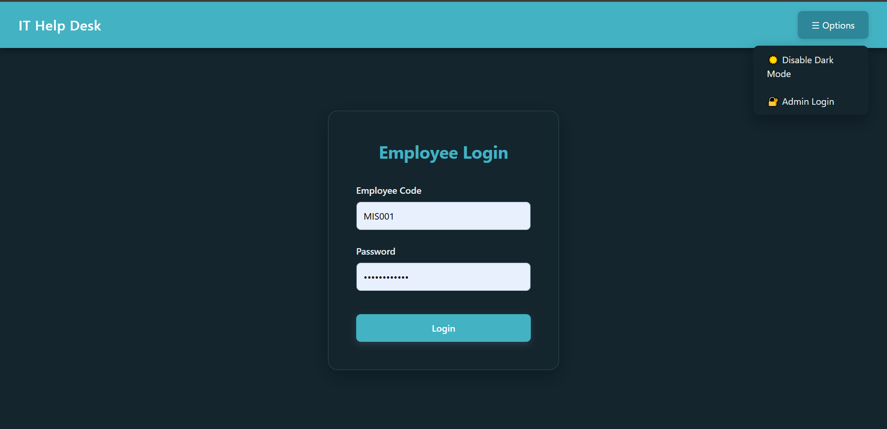
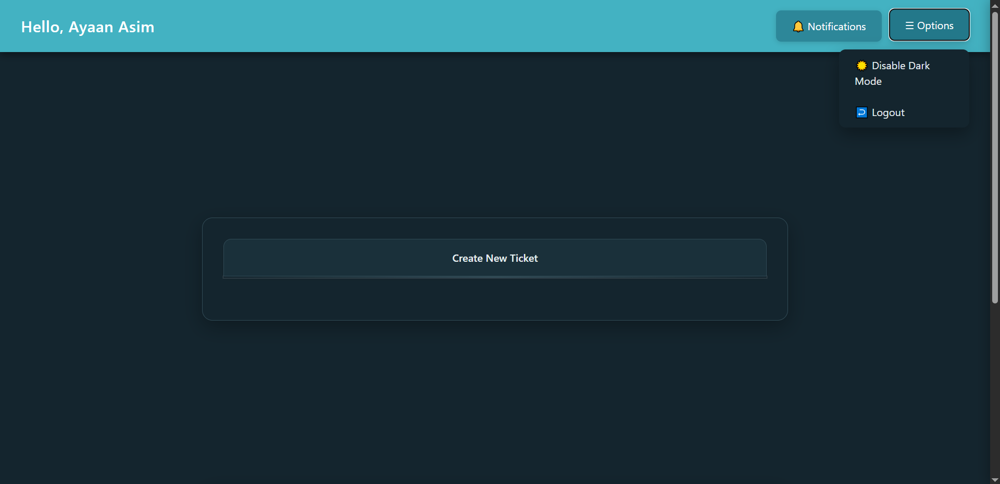
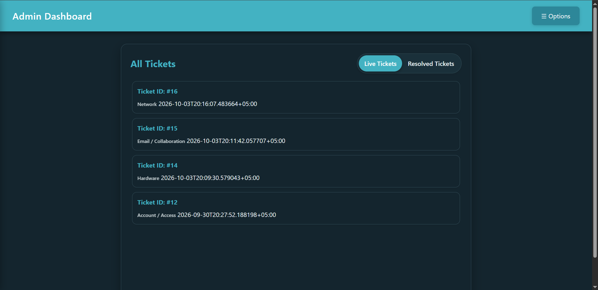
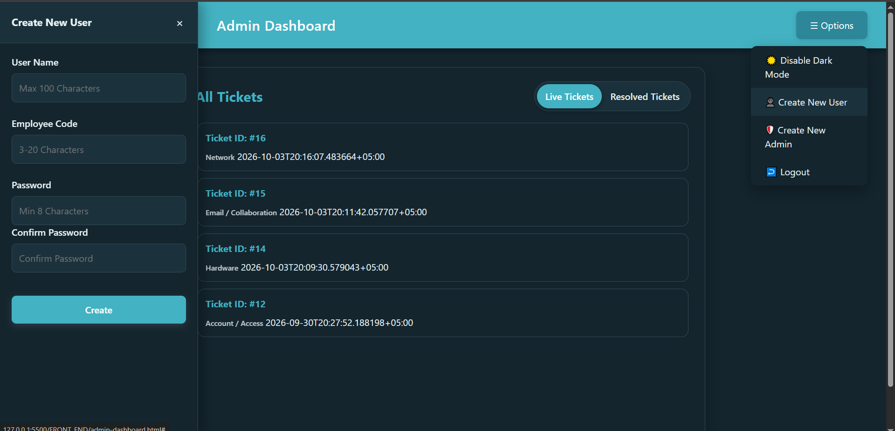
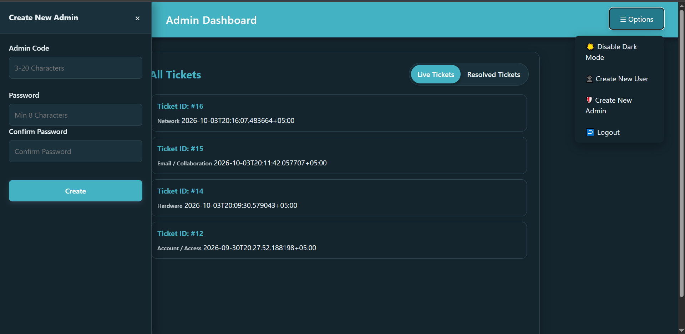
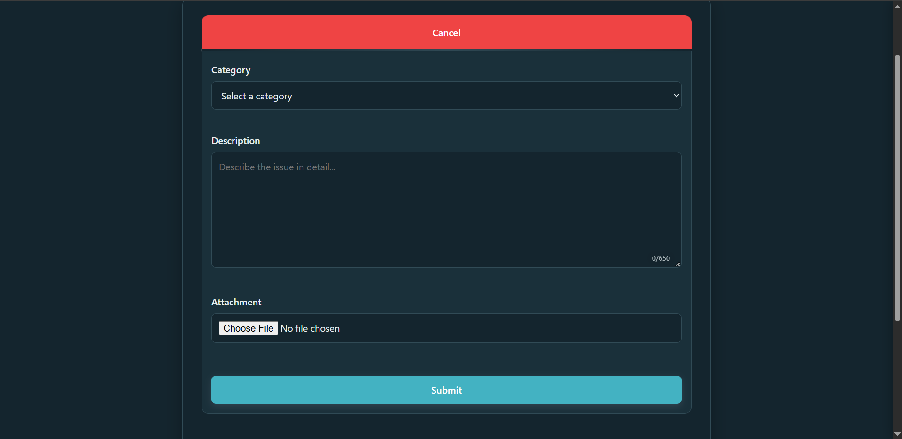
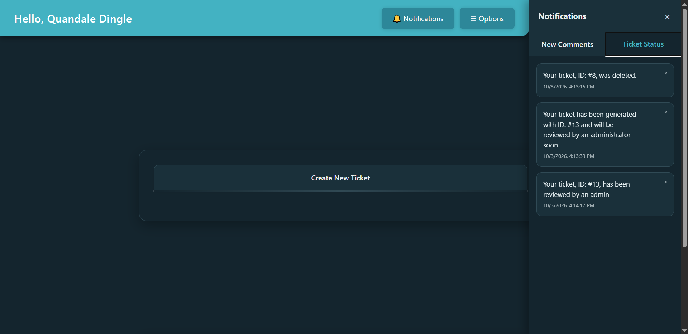
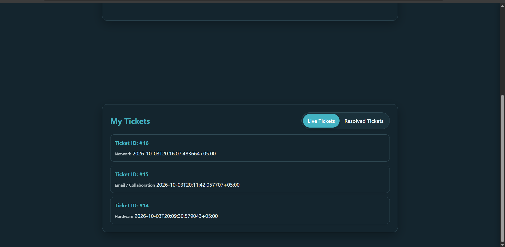
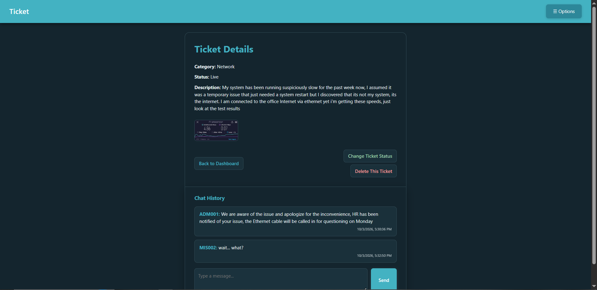

# IT Help Desk — Ticket Management System

A fullstack IT support ticket system where employees (users) submit tickets to IT admins and communicate with them directly on each ticket, built as a first solo fullstack project to learn backend development end-to-end, deployable in corporate office settings.

I built this project with Servis in mind, a company I worked at as an IT intern. Managing and handling IT-related issues from several people at the same time had always been a pain, especially when it's handled solely through WhatsApp group chats. That experience gave me the idea and the motivation to build this web app while simultaneously learning the stack.

## Features

- Separate employee and admin accounts with role-based authorization
- JWT authentication with short-lived access tokens and rotating, database-backed refresh tokens
- Ticket creation with optional image attachments (uploaded to Cloudinary), categorisation, and text descriptions
- Live/Resolved ticket filtering, with admins able to view and manage all tickets
- Per-ticket comment threads between employees and admins
- Notification system for ticket updates and new comments
- New employee and new admin registration/account creation, controlled by admins

## Tech Stack

**Backend:** Python, FastAPI, PostgreSQL, `psycopg` (async), PyJWT, bcrypt
**Frontend:** Vanilla HTML/CSS/JavaScript
**File storage:** Cloudinary

## Screenshots

## Setup

1. Clone the repo

git clone https://github.com/your-username/your-repo-name.git
cd your-repo-name

2. Set up a Python virtual environment and install dependencies

python -m venv venv
venv\Scripts\activate
pip install -r requirements.txt

3. Set up PostgreSQL and run the schema

psql -U postgres -d your_db_name -f database/schema.sql

4. Copy `.env.example` to `.env` and fill in your own credentials (database credentials, JWT secret, Cloudinary API)

5. Run the server

uvicorn main:app --reload

> **Note:** By default, every JavaScript `fetch` call in the frontend assumes the backend is running at `http://127.0.0.1:8000`. If you run it elsewhere, update the endpoint URLs in `script.js`.

6. Open the frontend HTML files in a browser (or serve them with a simple local server).

7. Create your first admin account

Since creating a new admin requires being logged in as an admin already, the very first one needs to be created directly through the API before you can log in anywhere:

- With the server running, go to `http://127.0.0.1:8000/docs`
- Find `POST /admins`, click "Try it out"
- Enter an `admin_code`, `password`, and `password_confirm`, then execute
- You can now log in as this admin at `admin-login.html`, and create further users/admins from the admin dashboard as normal

## What I learned

This was my first time building an actual application with code, not just something that runs in a terminal. I spent over a month on this project because I didn't even know what a framework was or how a backend connects to a frontend webpage when I started. While building it, I spent more than 90% of my time understanding what my own code was doing and how every piece worked together, rather than just getting things to run.

This project taught me how an API actually works, why JWT tokens are designed the way they are, how to design a relational database properly, how `fetch` calls work, general HTTP conventions, a lot of JavaScript, and, most importantly, logical reasoning and debugging.

## Known limitations

- No role-to-ticket assignment (any admin can act on any ticket) — a deliberate v1 scope decision
- Client-side status filtering rather than server-side query filtering for tickets (notifications are filtered server-side)